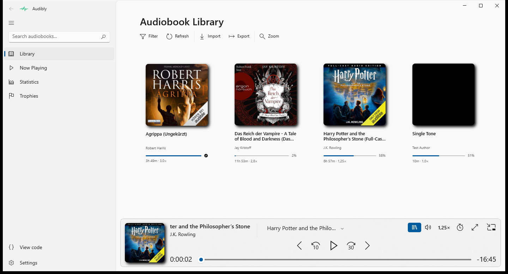
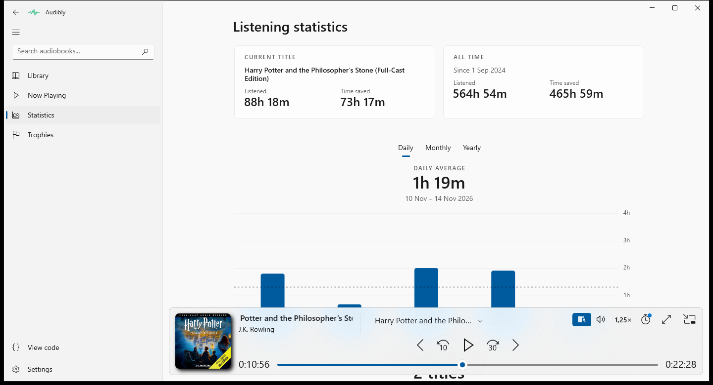
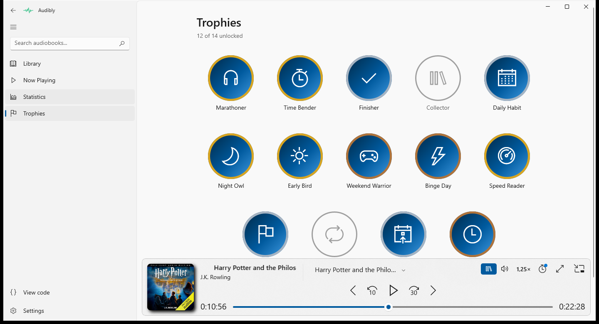
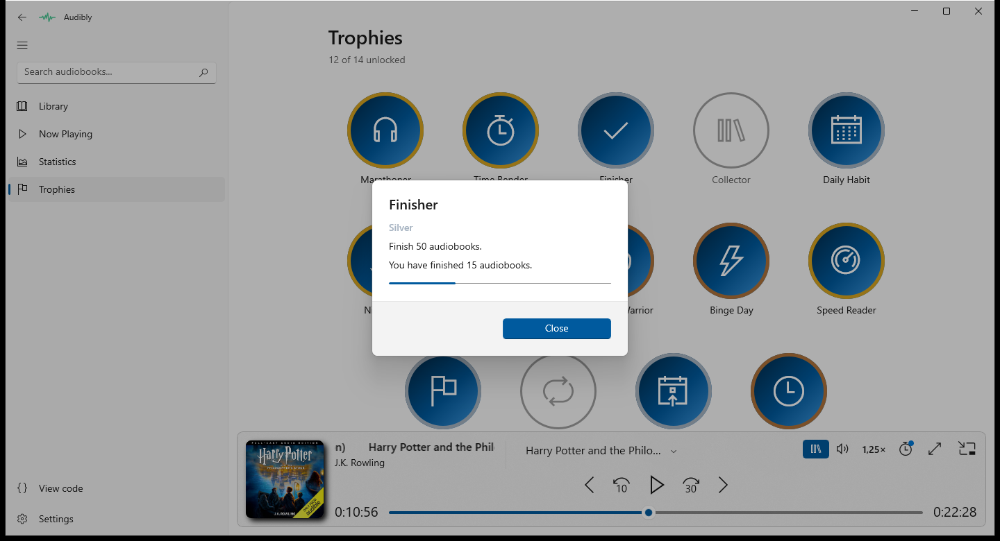
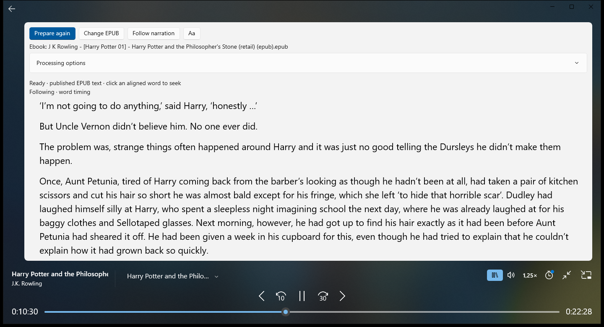
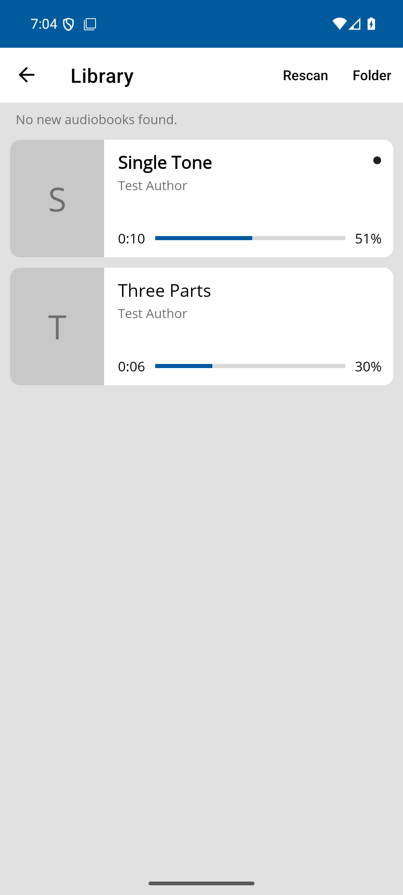
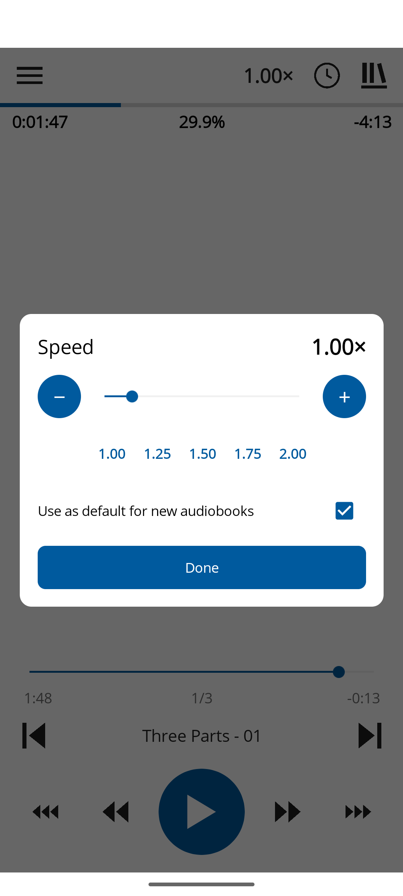

<a name="readme-top"></a>

<div align="center">
  

<h3 align="center">Audibly — Audiobook Player (extended fork)</h3>

  <p align="center">
    Audiobook player for Windows 10/11 and Android. Plays <code>.m4b</code>, <code>.m4a</code> and <code>.mp3</code>,
    including audiobooks made of many files, and continues on another device where you stopped.
  </p>
</div>

> This is a fork of [rstewa/Audibly](https://github.com/rstewa/Audibly). The original Windows app is available in the
> [Microsoft Store](https://apps.microsoft.com/detail/9p6r1m1gg9jr?mode=direct). This fork adds the features listed
> below; some of them are offered back to the original project as pull requests.

<details>
  <summary>Table of Contents</summary>
  <ol>
    <li><a href="#whats-new-in-this-fork">What's new in this fork</a></li>
    <li><a href="#screenshots">Screenshots</a></li>
    <li><a href="#sync-between-devices">Sync between devices</a></li>
    <li><a href="#building">Building</a></li>
    <li><a href="#project-structure">Project structure</a></li>
    <li><a href="#license">License</a></li>
    <li><a href="#acknowledgments">Acknowledgments</a></li>
  </ol>
</details>


## What's new in this fork

### Windows

- **Playback speed control** — the speed is shown as a number in the player; a flyout offers −/+ in 0.05× steps,
  a slider from 0.5× to 4×, quick picks and "use as default". The narrator's pitch is preserved.
- **Progress over the whole title** — the progress bar can cover the chapter or the full audiobook, and the time
  display can show elapsed/total, the time remaining at the current speed, or percent. Click the time to switch.
- **Listening statistics** — listening time and time saved by faster playback for the current title and in total,
  per day, month and year, and the number of titles in the library.
- **Trophies** — 14 achievements with bronze, silver and gold tiers, unlocked by listening; each shows what the next
  tier needs.
- **Read Along** — follow an EPUB word by word while the audiobook plays
  ([details](docs/read-along.md)).
- **Library** — books show their title and author, a progress bar and the length of the whole book at its
  playback speed; a click opens the book in the large player.
- **Better multi-file audiobooks** — named after their album, no skipped audio when one file ends, chapters named
  after their files when the files share one title tag, and no freezes with books of several hundred files.

### Android

- A player in the style of classic audiobook apps: progress of the whole book and of the chapter, time remaining
  at the current speed, large play button, short and long jumps, chapter list, sleep timer.
- Plays in the background with the usual media notification, lock screen and headset controls.
- Imports audiobooks from a folder on the phone; a subfolder with several files is one book.
- Remove books from the library, optionally deleting their files from the phone.
- Opens straight into the player with the book you listened to last.

### Both

- **Sync** — continue on another device at the same place; listening statistics count all devices together.
  See [Sync between devices](#sync-between-devices).

<p align="right">(<a href="#readme-top">back to top</a>)</p>


## Screenshots

### Windows: library and player
<p align="middle">
  
  
</p>

<sub>Each book shows its progress and the length of the whole book at its playback speed. A click opens it in the large player.</sub>

### Windows: listening statistics
<p align="middle">
  
  
</p>

### Windows: trophies
<p align="middle">
  
  
</p>

<sub>The numbers in the statistics and trophy screenshots are sample data.</sub>

### Windows: Read Along
<p align="middle">
  
</p>

### Android: player, library and speed
<p align="middle">
  
  
  
</p>


<p align="right">(<a href="#readme-top">back to top</a>)</p>


## Sync between devices

Audibly does not run a server and needs no account. Each device writes one small file into a folder that a cloud
service keeps in sync on all your devices, and reads the files of the others:

1. **Windows:** Settings → Sync → *Choose folder*, and pick a folder in Google Drive or OneDrive.
2. **Android:** Settings → *Choose sync folder*, and pick the same folder in the system folder dialog. Google Drive
   works well for this.
3. Listen on one device and pause. Once the cloud service has copied the file, open the same audiobook on the other
   device: it asks whether to continue where you stopped. Nothing changes until you answer.

The same audiobook is recognised on both devices by title and author, or by author and length when the titles differ.
The audio files themselves are not synced; copy them to each device yourself.

<p align="right">(<a href="#readme-top">back to top</a>)</p>


## Building

### Windows app

Windows 10/11 with the .NET 8 SDK and the Windows build tools for WinUI 3. The repository's `NuGet.Config` includes the
Community Toolkit Labs feed needed by the preview controls.

```powershell
dotnet build Audibly.App/Audibly.App.csproj -p:Platform=x64 -p:WindowsPackageType=None -p:AppxPackageSigningEnabled=false -p:GenerateAppxPackageOnBuild=false
dotnet test Audibly.Audio.Tests/Audibly.Audio.Tests.csproj
dotnet test Audibly.Stats.Tests/Audibly.Stats.Tests.csproj
dotnet test Audibly.Sync.Tests/Audibly.Sync.Tests.csproj
```

Read Along needs extra tools; see [docs/read-along.md](docs/read-along.md).

### Android app

The .NET 10 SDK with the `maui-android` workload, a JDK 17 and the Android SDK (API 36). The Android app has its own
solution, `Audibly.Mobile.slnx`, so the Windows solution keeps building with .NET 8.

```powershell
dotnet workload install maui-android
dotnet build Audibly.Mobile/Audibly.Mobile.csproj -t:InstallAndroidDependencies -f net10.0-android -p:AcceptAndroidSdkLicenses=True
dotnet publish Audibly.Mobile/Audibly.Mobile.csproj -f net10.0-android -c Release -p:AndroidPackageFormat=apk
```

The installable file is `Audibly.Mobile/bin/Release/net10.0-android/publish/app.audibly.mobile-Signed.apk`. Copy it
to the phone and open it; Android asks once to allow installing apps from that source. Android 8 or newer is required.

<p align="right">(<a href="#readme-top">back to top</a>)</p>


## Project structure

| Project | Purpose |
| --- | --- |
| `Audibly.App` | Windows app (WinUI 3) |
| `Audibly.Mobile` | Android app (.NET MAUI) |
| `Audibly.Core` | Shared playback logic and audiobook import, used by both apps |
| `Audibly.Models`, `Audibly.Repository` | Library data and database |
| `Audibly.Stats` | Listening statistics and trophies |
| `Audibly.Sync` | Sync between devices |
| `Audibly.ReadAlong` | Read Along alignment |
| `*.Tests` | Unit tests |

Design notes and implementation plans for the features of this fork are in [docs/superpowers](docs/superpowers).

<p align="right">(<a href="#readme-top">back to top</a>)</p>


## License

Distributed under the GNU General Public License v3.0. See `LICENSE` for more information.

Audio dependencies of the Windows app: [NAudio](https://github.com/naudio/NAudio) (MIT) and
[SoundTouch.NET](https://github.com/owoudenberg/soundtouch.net) (LGPL-2.1-or-later). They are used as separate,
unmodified assemblies; their license notices are in `Audibly.App/Assets/ThirdPartyNotices`. The Android app uses
[AndroidX Media3](https://developer.android.com/media/media3) (Apache 2.0).

<p align="right">(<a href="#readme-top">back to top</a>)</p>


## Acknowledgments

* [rstewa/Audibly](https://github.com/rstewa/Audibly), the original project this fork is based on
* [Rise Media Player](https://github.com/Rise-Software/Rise-Media-Player) for inspiration
* [Libation](https://github.com/rmcrackan/Libation) for the FolderIcon code
* [OpenAudible](https://openaudible.org/) for help with the original import code
* [Best-README-Template](https://github.com/othneildrew/Best-README-Template) for the original README template

<p align="right">(<a href="#readme-top">back to top</a>)</p>
