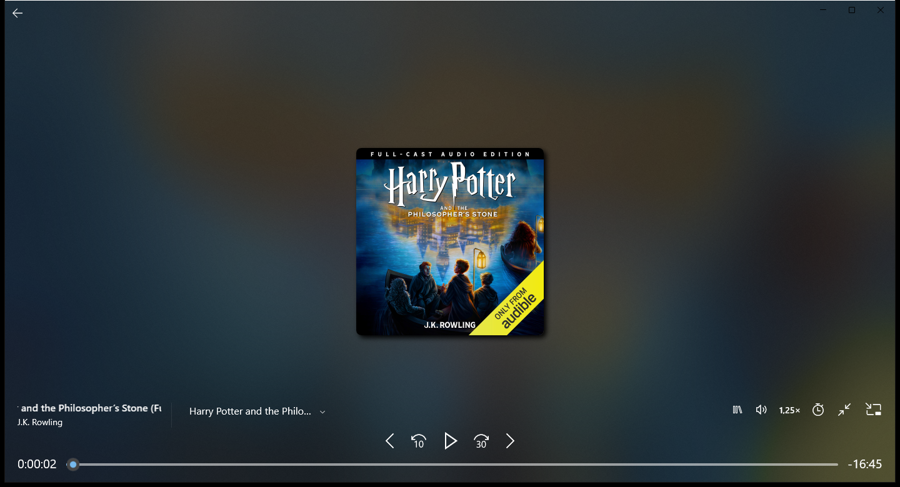
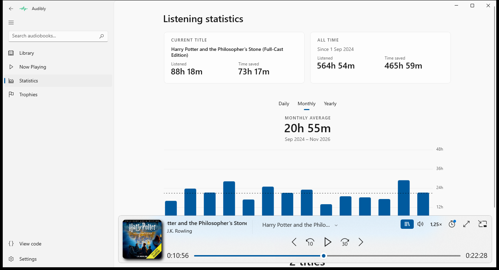
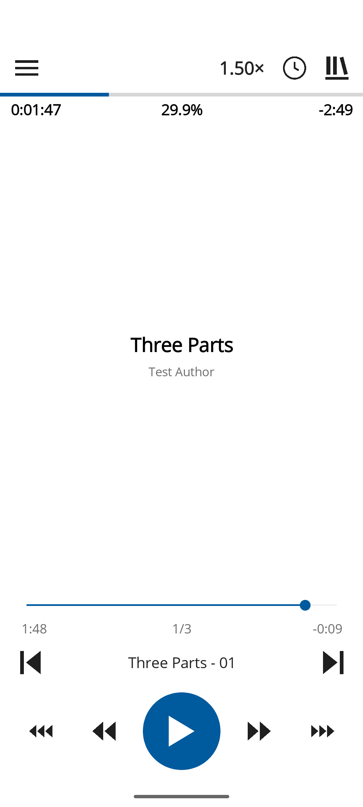

<a name="readme-top"></a>

<div align="center">
  

<h3 align="center">Audibly — Audiobook Player (extended fork)</h3>

  <p align="center">
    Audiobook player for Windows 10/11 and Android. Plays <code>.m4b</code>, <code>.m4a</code> and <code>.mp3</code>,
    including audiobooks made of many files, and continues on another device where you stopped.
  </p>
</div>

> This is a fork of [rstewa/Audibly](https://github.com/rstewa/Audibly). The original Windows app is available in the
> [Microsoft Store](https://apps.microsoft.com/detail/9p6r1m1gg9jr?mode=direct). This fork adds the features listed
> below; some of them are offered back to the original project as pull requests.

<details>
  <summary>Table of Contents</summary>
  <ol>
    <li><a href="#install">Install</a></li>
    <li><a href="#whats-new-in-this-fork">What's new in this fork</a></li>
    <li><a href="#changelog">Changelog</a></li>
    <li><a href="#screenshots">Screenshots</a></li>
    <li><a href="#sync-between-devices">Sync between devices</a></li>
    <li><a href="#building">Building</a></li>
    <li><a href="#project-structure">Project structure</a></li>
    <li><a href="#license">License</a></li>
    <li><a href="#acknowledgments">Acknowledgments</a></li>
  </ol>
</details>


## Install

The fork is released as **Audibly Fork** on the [Releases page](https://github.com/NicolasHartmann/Audibly/releases).
It installs next to the Store version of Audibly and keeps its own library.

### Windows 10/11 (x64)

The package is signed with the fork's own certificate, which Windows does not know yet. Trust it once:

1. Download `AudiblyFork.cer` and the `.msix` file from the release.
2. Right-click `AudiblyFork.cer` → **Install Certificate** → **Local Machine** → **Place all certificates in the
   following store** → **Browse** → **Trusted People** → OK → Finish. (Needs administrator rights.)

   Or in an administrator PowerShell: `Import-Certificate -FilePath .\AudiblyFork.cer -CertStoreLocation Cert:\LocalMachine\TrustedPeople`
3. Double-click the `.msix` file and choose **Install**.

If Windows says that `Microsoft.WindowsAppRuntime.1.7` is missing, install `Microsoft.WindowsAppRuntime.1.7-x64.msix`
from the release first, then the app.

Later versions install the same way, without the certificate step.

### Android 8 or newer

1. Download the `.apk` file from the release on the phone.
2. Open it and allow installing apps from this source when Android asks.
3. In the app, tap **Folder** and choose the folder with your audiobooks.

If you installed an earlier test build of the Android app, uninstall it first: the release is signed with a
different key, and Android does not install it over the old one.

## What's new in this fork

### Windows

- **Playback speed control** — the speed is shown as a number in the player; a flyout offers −/+ in 0.05× steps,
  a slider from 0.5× to 4×, quick picks and "use as default". The narrator's pitch is preserved.
- **Progress over the whole title** — the progress bar can cover the chapter or the full audiobook, and the time
  display can show elapsed/total, the time remaining at the current speed, or percent. Click the time to switch.
- **Listening statistics** — listening time and time saved by faster playback for the current title and in total,
  per day, month and year, and the number of titles in the library.
- **Trophies** — 14 achievements with bronze, silver and gold tiers, unlocked by listening; each shows what the next
  tier needs.
- **Read Along** — follow an EPUB word by word while the audiobook plays
  ([details](docs/read-along.md)).
- **Library** — books show their title and author, a progress bar and the length of the whole book at its
  playback speed; a click opens the book in the large player. The library shows how many books it holds.
- **Book details from the internet** — "Look up online…" in a book's menu finds it on Audible and fills in narrator,
  series and part, genres, release date and description; you choose field by field what to take over.
- **Better multi-file audiobooks** — named after their album, no skipped audio when one file ends, chapters named
  after their files when the files share one title tag, and no freezes with books of several hundred files.

### Android

- A player in the style of classic audiobook apps: progress of the whole book and of the chapter, time remaining
  at the current speed, large play button, short and long jumps, chapter list, sleep timer.
- Plays in the background with the usual media notification, lock screen and headset controls.
- Imports audiobooks from a folder on the phone; a subfolder with several files is one book.
- Remove books from the library, optionally deleting their files from the phone.
- Opens straight into the player with the book you listened to last.

### Both

- **Sync** — continue on another device at the same place; listening statistics count all devices together.
  See [Sync between devices](#sync-between-devices).

<p align="right">(<a href="#readme-top">back to top</a>)</p>


## Changelog

Changes in this fork compared with the original Audibly 2.2.10 (released 8 July 2026), newest first. The changes of
the original project up to 2.2.10 are in [CHANGELOG.md](CHANGELOG.md).

### 20–21 November 2026

- **Windows: tags.** Own tags per book (genres from "Look up online…" are added), editing many books at once,
  filtering the library by tag and listening time per tag in the statistics. The library shows how many books it has.
- **Windows: importing a whole library.** Importing a folder makes one book of every subfolder with audio files, in
  natural file order ("2" before "10"). Arranging the files by hand is a separate option.
- **Windows and Android: change a book's cover.** On Windows the image next to the book's files (cover.jpg,
  folder.jpg …) is offered first, or any image file; on Android any image.
- **Windows: clearer voice at higher speeds.** Time stretching now uses Sonic, the speech method of Android's
  ExoPlayer; word endings are much clearer than with SoundTouch. Settings → Player → Speed processing switches back.
- **Windows: back to earlier places.** The player remembers the last 5 places of each book (pauses and jumps of
  more than a minute); a button in the player goes back to one of them.
- **Windows: remove several books at once.** In selection mode the marked books can be removed from the library;
  their files stay on disk.
- **Windows: losing the audio output** (for example unplugging headphones) pauses the book at its position instead of
  closing it.
- First signed releases as **Audibly Fork** (see [Install](#install)).

### 19 November 2026

- **Windows: book details from the internet.** "Look up online…" in a book's menu searches Audible (German and US
  shop) and shows the hits with cover, narrator, series, length, year and language. After you pick the right edition,
  it lists the current and the found value of each field: narrator, series and part, genres, release date and
  description. Only ticked fields are saved, and an empty value never replaces an existing one. The genres are the
  basis for tags later.

### 18 November 2026

- **Windows: new library tiles.** Each book shows its title, author, a progress bar and its length at its playback
  speed. A click opens it in the large player.
- **Windows:** the library shows how many books it holds.
- **Windows:** the large player shows the cover again.

### 15–17 November 2026

- **Sync between Windows and Android** through a folder that a cloud service such as Google Drive or OneDrive keeps
  in sync. Opening a book on another device offers to continue where you stopped and never jumps without asking.
  Listening statistics and trophies count all devices together.
- **Android:** the player is the home screen, laid out like a classic audiobook player. The library is faster, and
  books can be removed with or without their files.
- **Windows: fixes**
  - Long audiobooks with hundreds of files no longer freeze the app while playing.
  - After the end-of-chapter sleep timer, a single Play continues with the next chapter.
  - The sync question no longer hides behind another dialog.

### 14 November 2026

- **Android app (new).**
  - Background playback with the media notification, lock screen and headset controls.
  - Imports a folder from the phone.
  - Library, player and settings, with chapter list, sleep timer and speed.
  - Shares the library logic with the Windows app.
- **Listening statistics:** listening time and the time saved by faster playback, per day, month and year.
- **Trophies:** 14 achievements with bronze, silver and gold tiers.
- **Progress over the whole title:** the progress bar can cover the chapter or the whole book, and the time display can
  show elapsed/total, the time remaining at the current speed, or percent.
- **Multi-file audiobooks:** chapters are named after their files when all files carry the same title tag.
- **Read Along:** the marker follows the narration on every frame and no longer skips words.

### 13 November 2026

- **Playback speed control:** the speed is shown as a number in the player. A flyout offers −/+ in 0.05× steps, a
  slider from 0.5× to 4×, quick picks and "use as default". The narrator's pitch is preserved.
- **Fix:** multi-file audiobooks no longer skip part of the next chapter when one file ends.
- **Mini player:** the progress row stays visible when the Read Along captions are hidden.

### 1–6 November 2026

- **Read Along (new):** follow an EPUB word by word while the audiobook plays.
  - The alignment is computed locally (Storyteller), on the GPU where available.
  - EPUB 2 books are upgraded automatically.
  - Preparation shows its progress, and errors can be copied.
  - Captions can appear above the mini player.
- **Improved speed and mini-player controls.**
- **Local installs** use the normal Audibly name and app icon.

<p align="right">(<a href="#readme-top">back to top</a>)</p>


## Screenshots

### Windows: library and player
<p align="middle">
  
  
</p>

<sub>Each book shows its progress and the length of the whole book at its playback speed. A click opens it in the large player.</sub>

### Windows: listening statistics
<p align="middle">
  
  
</p>

### Windows: trophies
<p align="middle">
  
  
</p>

<sub>The numbers in the statistics and trophy screenshots are sample data.</sub>

### Windows: Read Along
<p align="middle">
  
</p>

### Android: player, library and speed
<p align="middle">
  
  
  
</p>


<p align="right">(<a href="#readme-top">back to top</a>)</p>


## Sync between devices

Audibly does not run a server and needs no account. Each device writes one small file into a folder that a cloud
service keeps in sync on all your devices, and reads the files of the others:

1. **Windows:** Settings → Sync → *Choose folder*, and pick a folder in Google Drive or OneDrive.
2. **Android:** Settings → *Choose sync folder*, and pick the same folder in the system folder dialog. Google Drive
   works well for this.
3. Listen on one device and pause. Once the cloud service has copied the file, open the same audiobook on the other
   device: it asks whether to continue where you stopped. Nothing changes until you answer.

The same audiobook is recognised on both devices by title and author, or by author and length when the titles differ.
The audio files themselves are not synced; copy them to each device yourself.

<p align="right">(<a href="#readme-top">back to top</a>)</p>


## Building

### Windows app

Windows 10/11 with the .NET 8 SDK and the Windows build tools for WinUI 3. The repository's `NuGet.Config` includes the
Community Toolkit Labs feed needed by the preview controls.

```powershell
dotnet build Audibly.App/Audibly.App.csproj -p:Platform=x64 -p:WindowsPackageType=None -p:AppxPackageSigningEnabled=false -p:GenerateAppxPackageOnBuild=false
dotnet test Audibly.Audio.Tests/Audibly.Audio.Tests.csproj
dotnet test Audibly.Stats.Tests/Audibly.Stats.Tests.csproj
dotnet test Audibly.Sync.Tests/Audibly.Sync.Tests.csproj
```

Read Along needs extra tools; see [docs/read-along.md](docs/read-along.md).

### Android app

The .NET 10 SDK with the `maui-android` workload, a JDK 17 and the Android SDK (API 36). The Android app has its own
solution, `Audibly.Mobile.slnx`, so the Windows solution keeps building with .NET 8.

```powershell
dotnet workload install maui-android
dotnet build Audibly.Mobile/Audibly.Mobile.csproj -t:InstallAndroidDependencies -f net10.0-android -p:AcceptAndroidSdkLicenses=True
dotnet publish Audibly.Mobile/Audibly.Mobile.csproj -f net10.0-android -c Release -p:AndroidPackageFormat=apk
```

The installable file is `Audibly.Mobile/bin/Release/net10.0-android/publish/app.audibly.mobile-Signed.apk`. Copy it
to the phone and open it; Android asks once to allow installing apps from that source. Android 8 or newer is required.

<p align="right">(<a href="#readme-top">back to top</a>)</p>


## Project structure

| Project | Purpose |
| --- | --- |
| `Audibly.App` | Windows app (WinUI 3) |
| `Audibly.Mobile` | Android app (.NET MAUI) |
| `Audibly.Core` | Shared playback logic and audiobook import, used by both apps |
| `Audibly.Models`, `Audibly.Repository` | Library data and database |
| `Audibly.Stats` | Listening statistics and trophies |
| `Audibly.Sync` | Sync between devices |
| `Audibly.ReadAlong` | Read Along alignment |
| `*.Tests` | Unit tests |

Design notes and implementation plans for the features of this fork are in [docs/superpowers](docs/superpowers).

<p align="right">(<a href="#readme-top">back to top</a>)</p>


## License

Distributed under the GNU General Public License v3.0. See `LICENSE` for more information.

Audio dependencies of the Windows app: [NAudio](https://github.com/naudio/NAudio) (MIT) and
[SoundTouch.NET](https://github.com/owoudenberg/soundtouch.net) (LGPL-2.1-or-later). They are used as separate,
unmodified assemblies; their license notices are in `Audibly.App/Assets/ThirdPartyNotices`. The Android app uses
[AndroidX Media3](https://developer.android.com/media/media3) (Apache 2.0).

<p align="right">(<a href="#readme-top">back to top</a>)</p>


## Acknowledgments

* [rstewa/Audibly](https://github.com/rstewa/Audibly), the original project this fork is based on
* [Rise Media Player](https://github.com/Rise-Software/Rise-Media-Player) for inspiration
* [Libation](https://github.com/rmcrackan/Libation) for the FolderIcon code
* [OpenAudible](https://openaudible.org/) for help with the original import code
* [Best-README-Template](https://github.com/othneildrew/Best-README-Template) for the original README template

<p align="right">(<a href="#readme-top">back to top</a>)</p>
